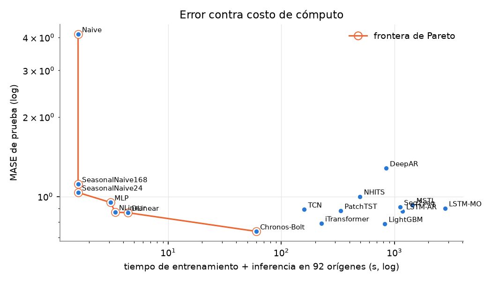
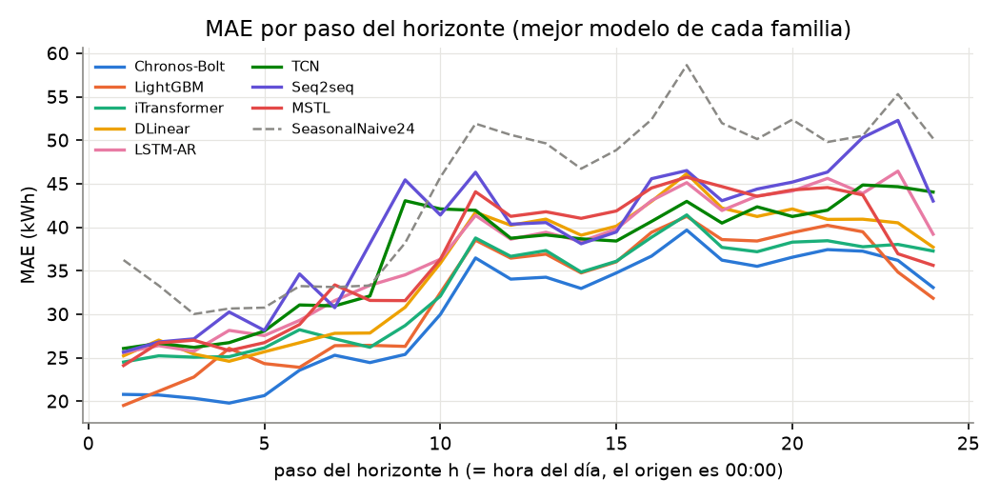
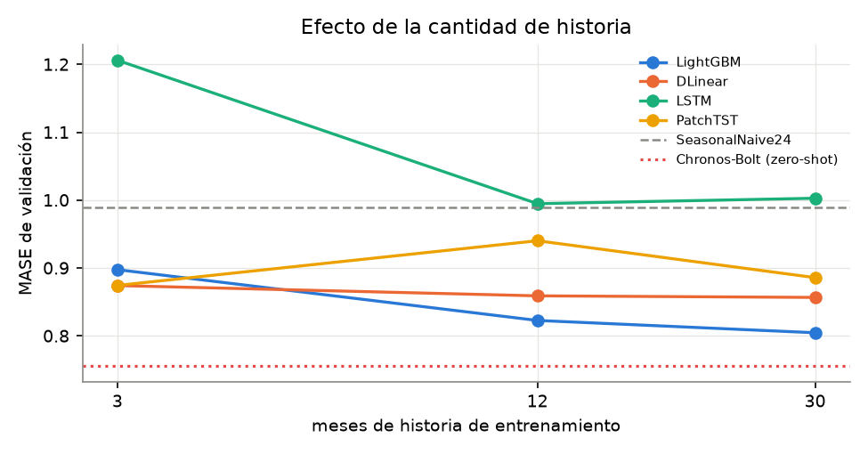
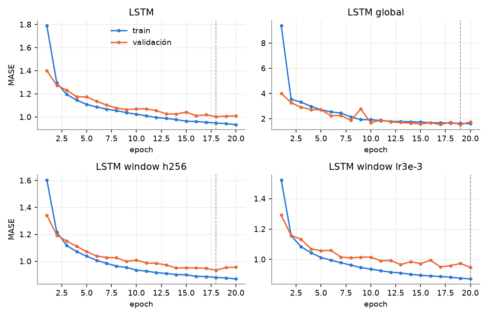
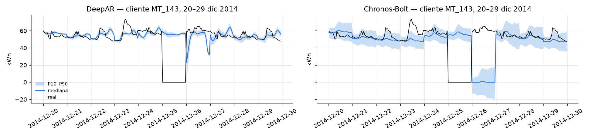

**Laboratorio 9 — Series de tiempo y forecasting** · CC3092 Deep Learning y Sistemas Inteligentes · Pronóstico *day-ahead* (H = 24 h) del consumo horario de 100 clientes de Portugal (UCI ElectricityLoadDiagrams20112014) · Hardware: MacBook Pro Apple M5 Pro (redes en PyTorch MPS; StatsForecast y LightGBM en CPU, en un hilo paralelo al entrenamiento en GPU).

## 1. Investigación (resumen; detalle en `investigacion.md`)

**`nn.LSTM`/`nn.GRU`** reciben `(B, L, input_size)` con `batch_first=True`; `output` es `(B, L, D·hidden)` (última capa, todos los pasos) y `h_n`, `c_n` son `(D·num_layers, B, hidden)` (último paso, todas las capas). `dropout` solo actúa entre capas y `batch_first` no cambia la forma de `h_n`. La cabeza multi-salida usa `h_n[-1]`; el seq2seq pasa `(h_n, c_n)` al decoder. **`nn.Conv1d` con `dilation=d`** mira `t, t−d, …, t−(k−1)d`; para que sea causal se rellena solo a la izquierda con `(k−1)d` (`padding="same"` filtra el futuro). El campo receptivo de una TCN es $R = 1+\sum_i (k-1)d_i$; con `k = 2` y `d = 1, 2, …, 128` (nuestra TCN) $R = 256$ h. **`TransformerEncoderLayer`** (`d_model`, `nhead`, `dim_feedforward`, `norm_first`) no conoce el orden: se suma una codificación posicional (sinusoidal o aprendida) a cada token (en PatchTST, a cada *patch* de 24 h). **Nixtla** usa un `DataFrame` largo `unique_id, ds, y` (+ covariables futuras en `futr_df`). `cross_validation(h, n_windows, step_size, refit)` crea `n_windows` cortes separados `step_size` y devuelve `unique_id, ds, cutoff, y, <modelo>`. **Chronos** `predict_quantiles(inputs, prediction_length, quantile_levels)` devuelve cuantiles `(n, H, q)` y la media `(n, H)`. **Conceptos:** un modelo *global* comparte pesos entre series (más datos y transferencia entre clientes) y uno *local* ajusta uno por serie. *Teacher forcing* entrena con el valor real como entrada y causa *exposure bias* al inferir con predicciones propias. **RevIN** normaliza cada ventana con su media y desviación y desnormaliza la salida. La **pinball loss** $\max(\tau e, (\tau-1)e)$ entrena cuantiles. **MASE** divide el MAE entre el MAE del *seasonal naive* (m = 24) dentro de train: es comparable entre clientes de escalas muy distintas. **WAPE** = $\sum|e|/\sum|y|$ lo dominan los clientes grandes.

## 2. Preparación de la serie

- **Marca de tiempo.** Cada registro de 15 min está etiquetado al **final** del intervalo (los clientes empiezan en 2012-01-01 00:15). La hora *h* agrega `h:15, h:30, h:45, (h+1):00`; kWh = suma/4 (los datos vienen en kW).
- **Clientes.** 370 $\to$ 320 con consumo antes de 2012 $\to$ 318 activos hasta diciembre 2014 $\to$ **314** sin rachas de ceros > 24 h. Panel completo: 314 × 26 304 h = **8 259 456** observaciones. Se usa un subconjunto de **100 clientes** (`seed = 42`): 2 630 400 observaciones.
- **Horario de verano.** En el último domingo de marzo, los registros 01:00–01:45 valen 0 (la hora no existe) y se interpolan. En el último domingo de octubre vienen sumadas las dos horas (el panel vale 2× lo normal) y se dividen entre 2. Por ejemplo, el 2014-10-26 la hora pasa de 233 706 a 116 853 kWh y el 2014-03-30 de 418 a 113 047 kWh.
- **Perfiles.** El consumo diario tiene dos picos (mañana y noche) y el domingo baja 3.5 % respecto de la media. El 25 de diciembre y el 1 de enero caen entre −33 % y −54 % respecto del mismo día de la semana anterior. Los días 24 y 31 de diciembre caen solo entre −3 % y −8 % (figura `perfiles.png`, `navidad.png`).
- **Escalas.** La media por cliente va de 20.9 a 11 480 kWh/h (550×). Se elige **z-score por serie con estadísticos de train**, porque una normalización global deja a los clientes pequeños en ≈ 0. También se prueban global y RevIN (por ventana). La pérdida de entrenamiento es la MASE del lote: el error se divide entre la escala de cada cliente.
- **Covariables de calendario** (conocidas a futuro): seno/coseno de hora, día de la semana y mes (continuidad 23 h $\to$ 0 h), y un indicador de feriado (feriados de Portugal más 24 y 31 de diciembre). LightGBM las recibe como enteros categóricos.
- **Dataset de ventanas.** `X: (B, L, 8)` (consumo + 7 covariables), covariables futuras `(B, H, 7)` e `y: (B, H)`. Con L = 168, H = 24 y *stride* 1 hay **21 697 / 2 185 / 2 185** ventanas por serie en train/val/test. Esto da 2 169 700 / 218 500 / 218 500 en el panel usado y 6 812 858 / 686 090 / 686 090 en el panel completo.

## 3. Auditoría de fugas y protocolo

Celdas con `assert` en el notebook:

- **(i)** No hay *split* aleatorio de ventanas: los objetivos de train terminan en 2014-06-30 23:00, validación es julio–septiembre y prueba octubre–diciembre.
- **(ii)** Los estadísticos de normalización se calculan solo con train. Son idénticos aunque val/test se corrompan con 10⁶.
- **(iii)** El *early stopping* usa validación. El último objetivo de validación (2014-09-30 23:00) es anterior al inicio de prueba.
- **(iv)** En el origen 2014-10-01 00:00 la última entrada es 23:00 del día anterior y las covariables futuras son las de las horas objetivo. Además, alterar los datos posteriores al origen no cambia el pronóstico.

`backtest(modelo)` es la única función de evaluación. Hace *rolling origin* con 92 orígenes diarios a las 00:00 (H = 24) y el modelo entrenado una vez con datos ≤ 2014-09-30. Con `retrain="monthly"` reentrena al inicio de octubre, noviembre y diciembre con ventana expansiva. Reporta MAE, RMSE, WAPE, MAPE, MASE, MAE por paso y por hora, MASE de la semana del 22 al 28 de diciembre y, si hay cuantiles, pinball y cobertura P10–P90.

## 4. Iteraciones (validación, H = 24)

Todas las redes propias usan el mismo presupuesto: 80 000 ventanas por epoch, hasta 20 epochs, paciencia 4 sobre la MASE de validación, Adam con lr = 10⁻³, batch 512 y *clipping* 1.0. Por epoch se registran la pérdida de train y de validación, el MAE y la MASE de validación, el tiempo y la memoria pico de la GPU (`results/iteraciones.csv`, `curvas_perdida.png`).

| Iteración (LSTM multi-salida, 2 capas, 128) | val MASE | Iteración | val MASE |
|---|---:|---|---:|
| L = 48 / 168 / 336 | 1.004 / 1.008 / **1.003** | DLinear L = 168 / 336 | 0.873 / **0.857** |
| L336, historia 3 / 12 / 30 meses | 1.206 / 0.995 / 1.003 | DLinear L336, RevIN | 0.859 |
| L336, normalización global | 1.534 | DLinear L336, historia 3 / 12 meses | 0.874 / 0.859 |
| L336, RevIN (por ventana) | 0.987 | NLinear L = 168 / 336 | 0.873 / 0.862 |
| RevIN + hidden 256 | **0.934** | MLP L = 168 / 336 | **0.977** / 1.011 |
| RevIN + 1 capa / dropout 0.3 | 1.017 / 0.998 | TCN L = 168 / 336 | 0.905 / **0.900** |
| RevIN + lr 3·10⁻³ / batch 1024 | 0.948 / 1.036 | PatchTST historia 3 / 12 / 30 m | 0.875 / 0.940 / 0.886 |

- **La ventana L** casi no cambia la LSTM (1.003–1.008). En los lineales L = 336 sí ayuda, porque ven dos semanas.
- **La normalización** es lo que más pesa: la global es 53 % peor (los clientes pequeños quedan en ≈ 0) y RevIN mejora 1.6 %.
- **La capacidad** importa: con hidden 256 la MASE baja a 0.934, con 3.7× parámetros (914 k).
- **La historia:** 3 meses son insuficientes para la LSTM (1.206), y entre 12 y 30 meses la diferencia es mínima.
- **El costo** es muy distinto: una LSTM tarda ≈ 280 s en entrenar (13 s por epoch) y un lineal ≈ 4 s.
- Los tiempos de `L336_3m`, `L336_window` y `h256` están inflados ≈ 2×, porque se midieron mientras otro proceso compartía la GPU (ver §7).

## 5. Estrategias multi-paso (LSTM, prueba, MAE en kWh)

| Paso | h = 1 | h = 6 | h = 12 | h = 18 | h = 24 | MASE |
|---|---:|---:|---:|---:|---:|---:|
| Autorregresiva (teacher forcing, recursiva al inferir) | 25.6 | **29.3** | **38.6** | 41.9 | **39.2** | **0.880** |
| Multi-salida directa (cabeza de H salidas) | 26.3 | 32.7 | 38.8 | **41.4** | 42.1 | 0.903 |
| Encoder–decoder (seq2seq, teacher forcing 0.5) | 25.7 | 34.6 | 40.4 | 43.1 | 43.0 | 0.912 |

Las tres estrategias usan la mejor configuración de la LSTM (L = 336, RevIN, hidden 256). Gana la **autorregresiva**: en cada paso recibe el calendario de la hora siguiente y su propia predicción, y el error no se acumula mucho en 24 h porque el patrón diario es muy regular. La multi-salida predice las 24 horas con un único vector y suaviza la mañana. El seq2seq sufre más *exposure bias* (teacher forcing 0.5). En todas las familias el error sigue el **perfil del día** más que el paso: es bajo de madrugada (h = 1–6), sube con el pico de la mañana (h = 8–12) y se queda alto hasta la noche. Los modelos multi-salida no muestran una deriva monótona (`mae_por_paso.png`).

## 6. Comparación de todos los modelos (prueba, 92 orígenes, H = 24, ordenada por MASE)

| Modelo | Familia | L | Estrategia | Cov. | Params | Train s | Infer s | HW | MAE | RMSE | WAPE | MASE | MASE H=168 | MASE Nav. | Pinball | Cob. 80 |
|---|---|--:|---|---|--:|--:|--:|---|--:|--:|--:|--:|--:|--:|--:|--:|
| Chronos-Bolt | Fundacional | 2048 | multi-sal. | no | 205.3 M | 0 | 60.1 | MPS | 30.5 | 195.9 | 0.059 | **0.738** | 0.919 | 1.332 | 0.247 | 79.9 % |
| LightGBM | Árboles | 168 | directa | sí | 765 k | 764 | 59.1 | CPU | 32.3 | 169.6 | 0.063 | **0.788** | – | 1.395 | – | – |
| iTransformer | Atención | 168 | multi-sal. | no | 290 k | 224 | 1.9 | MPS | 33.2 | 171.8 | 0.064 | **0.792** | – | 1.383 | – | – |
| DLinear | Lineal | 336 | multi-sal. | no | 16 k | 4 | 0.0 | MPS | 35.6 | 185.7 | 0.069 | **0.869** | 0.995 | 1.857 | – | – |
| NLinear | Lineal | 336 | multi-sal. | no | 8 k | 3 | 0.0 | MPS | 35.7 | 186.1 | 0.069 | **0.873** | 0.987 | 1.838 | – | – |
| LSTM-AR | Recurr. | 336 | autorreg. | sí | 799 k | 1160 | 16.0 | MPS | 37.1 | 191.9 | 0.072 | **0.880** | – | 1.494 | – | – |
| PatchTST | Atención | 168 | multi-sal. | no | 445 k | 334 | 0.9 | MPS | 36.8 | 185.8 | 0.071 | **0.883** | – | 1.630 | – | – |
| TCN | Convol. | 336 | multi-sal. | sí | 76 k | 159 | 0.3 | MPS | 37.2 | 179.5 | 0.072 | **0.893** | – | 1.519 | – | – |
| LSTM-MO | Recurr. | 336 | multi-sal. | sí | 914 k | 2769 | 34.2 | MPS | 38.7 | 189.6 | 0.075 | **0.903** | – | 1.317 | – | – |
| Seq2seq | Enc.–dec. | 336 | enc.–dec. | sí | 1.6 M | 1113 | 11.4 | MPS | 39.6 | 200.2 | 0.077 | **0.912** | – | 1.406 | – | – |
| MSTL | Baseline | 2016 | directa | no | 0 | 66 | 1379.4 | CPU | 36.9 | 194.2 | 0.072 | **0.928** | 1.134 | 2.030 | – | – |
| MLP | MLP | 168 | multi-sal. | sí | 213 k | 3 | 0.0 | MPS | 39.5 | 176.0 | 0.077 | **0.950** | – | 1.434 | – | – |
| NHITS | MLP jerárq. | 168 | multi-sal. | sí | 4.2 M | 496 | 0.9 | MPS | 41.7 | 193.9 | 0.081 | **1.000** | – | 1.520 | – | – |
| SNaive24 | Baseline | 0 | directa | no | 0 | 0 | 1.6 | CPU | 44.3 | 234.0 | 0.086 | **1.036** | 1.215 | 2.167 | – | – |
| SNaive168 | Baseline | 0 | directa | no | 0 | 0 | 1.6 | CPU | 39.9 | 183.8 | 0.078 | **1.114** | 1.119 | 1.601 | – | – |
| DeepAR | Probabil. | 168 | autorreg. | sí | 203 k | 832 | 10.3 | MPS | 50.5 | 214.5 | 0.098 | **1.280** | – | 2.005 | 0.458 | 57.9 % |
| Naive | Baseline | 0 | directa | no | 0 | 0 | 1.6 | CPU | 164.7 | 532.5 | 0.320 | **4.118** | 4.168 | 3.993 | – | – |

MASE H=168 es el pronóstico semanal (86 orígenes diarios). MASE Nav. es la MASE de los objetivos del 22 al 28 de diciembre. El tiempo de entrenamiento incluye la validación del *early stopping*. La inferencia es de los 92 orígenes. Los modelos propios y los de NeuralForecast usan MPS; MSTL y LightGBM, la CPU. Para LightGBM, "params" es el número aproximado de hojas (árboles × hojas máximas).

{width=49%} {width=49%}

{width=49%} {width=49%}

**Probabilístico.**

| Modelo | Pinball (escalada) | Cobertura P10–P90 |
|---|---:|---:|
| Chronos-Bolt | **0.247** | **79.9 %** |
| DeepAR | 0.458 | 57.9 % |

Los intervalos de Chronos están **calibrados**: la cobertura es 79.9 % para un nominal de 80 %. DeepAR los subestima (cobertura de 58 %) y su mediana es la peor de los modelos entrenados (MASE 1.28). Sin *early stopping*, sus 1 500 pasos fijos no alcanzan, y su verosimilitud Student-t no se ajusta a series con escalas 550× distintas (`probabilistico.png`).

{width=80%}

## 7. Discusión

**¿Qué modelo ganó y por cuánto superó al seasonal naive?**

- **Chronos-Bolt zero-shot** tiene MASE **0.738**, **28.7 % menos error** que el seasonal naive de 24 h (1.036).
- Entre los modelos entrenados ganan **LightGBM (0.788)** e **iTransformer (0.792)**, empatados en la práctica (−24 %).
- La mejora sí justifica el costo, pero no el de cualquier red:
  - Chronos no se entrena y hace la inferencia de 92 días en 60 s, aunque tiene 205 M parámetros.
  - LightGBM tarda 13 min en CPU.
  - DLinear (0.869) tarda 4 s en entrenar con 16 k parámetros y aun así le gana a MSTL, a la LSTM y a N-HiTS.
- En producción, LightGBM o DLinear son los más fáciles de mantener (reentrenarlos es barato y su error es predecible). Chronos es la mejor opción si se puede servir un modelo grande.

**¿Un modelo lineal compite con los Transformers?** Sí, en parte:

- DLinear y NLinear (0.869 / 0.873) le ganan a PatchTST (0.883), a la TCN (0.893), a la LSTM (0.880–0.912) y a N-HiTS (1.000).
- Pierden contra iTransformer (0.792), que modela la relación entre clientes.
- En el horizonte semanal (H = 168), DLinear (0.995) y NLinear (0.987) quedan por delante del seasonal naive semanal (1.119) y de MSTL (1.134), pero detrás de Chronos (0.919).
- La ventaja lineal crece con el horizonte, como en el artículo de DLinear.

**¿Qué efecto tuvieron L, la normalización y la historia?** Ver §4.

- La **normalización** fue el factor dominante (global: +53 %).
- **L** solo ayudó a los lineales.
- La **historia** importa por debajo de 12 meses. Con 3 meses, la LSTM sube a 1.206 y LightGBM a 0.898, mientras que DLinear (0.874) y PatchTST (0.875) casi no cambian.
- El cruce con LightGBM ocurre al revés de lo esperado (`historia.png`):
  - con **3 meses**, el DL **sí supera a LightGBM** (DLinear 0.874 y PatchTST 0.875 contra 0.898), porque LightGBM pierde *lags* útiles con pocos datos;
  - desde **12 meses**, LightGBM recupera la ventaja (0.823 y 0.805 contra 0.859 y 0.857).
- Frente al seasonal naive (0.990), DLinear y PatchTST son mejores con cualquier historia. La LSTM base (sin RevIN ni hidden 256) nunca lo supera en validación. Solo su mejor configuración baja de él (0.934).
- iTransformer, entrenado con 30 meses, empata con LightGBM en prueba.

**¿Global o local?** Para 10 clientes, DLinear local (uno por cliente) obtiene MASE 0.896 y el global 0.895, un empate.

- El global ayuda más a los clientes **irregulares o muy grandes**: MT_279, el de mayor consumo (+2.7 %), y MT_174, el de peor MASE (+2.5 %).
- Los regulares quedan igual o un poco mejor con su propio modelo (−1 % a −2.5 %).
- La ventaja real del global es operativa: un solo modelo de 16 k parámetros en vez de 100, y sirve a clientes nuevos.

**¿Qué tan cerca quedó Chronos?** No solo quedó cerca: **ganó** a todos los modelos entrenados (0.738 contra 0.788), y además da intervalos calibrados. Lo usaríamos:

- con clientes nuevos o poca historia (con 3 meses, la LSTM y LightGBM empeoran mucho y Chronos no necesita entrenamiento);
- como baseline inmediato antes de invertir en entrenamiento;
- cuando hacen falta cuantiles.

Entrenaríamos una red cuando la latencia o el costo de servir 205 M parámetros importen, o cuando haya covariables propias (precio, clima) que Chronos no usa.

**¿Qué pasó en Navidad y Año Nuevo?** Todos los modelos empeoran del 22 al 28 de diciembre, pero no por igual:

- Los modelos **con covariable de feriado** se degradan menos: la LSTM multi-salida tiene la mejor MASE navideña (1.317, +46 %), seguida de MLP (+51 %), N-HiTS (+52 %), seq2seq (+54 %), LSTM autorregresiva (+70 %) y TCN (+70 %).
- Los que **no ven el calendario** se degradan el doble: DLinear (+114 %), NLinear (+111 %), MSTL (+119 %), seasonal naive (+109 %).
- Chronos (+80 %) queda en medio. No tiene calendario (su contexto de 2 048 h ≈ 85 días no alcanza la Navidad anterior), así que solo ve la caída cuando ya ocurrió.
- El indicador de feriado ayuda, pero no elimina el cambio de régimen. Solo hay dos Navidades en train y la del 2014 fue más profunda (−54 %).

**¿Qué tan sensible es a la semilla?** iTransformer, el mejor DL en validación, con semillas 42/43/44 obtiene MASE 0.792 / 0.784 / 0.779:

- media **0.785 ± 0.007** (desviación estándar);
- diferencias de menos de 0.01, del mismo orden que la ventaja de LightGBM sobre iTransformer: ese empate no es significativo con una sola semilla.

**Reentrenamiento mensual** (ventana expansiva): casi no aporta. iTransformer pasa de 0.792 a 0.790 y MSTL de 0.928 a 0.926, con 3× el costo (638 s). Tres meses no alcanzan para que la serie se aleje de lo que vio el modelo.

**MAPE:** no tiene sentido en clientes cercanos a cero (se excluyen las horas con consumo 0). Con el mejor modelo, la mediana por cliente es 6.4 % y el máximo 36.8 %. Por eso se usa la MASE para ordenar.

**Notas de ejecución:**

- La TCN de NeuralForecast divergió con los orígenes apilados como series independientes (MASE de validación 22.5). Se reemplazó por una **TCN propia**: 8 convoluciones causales dilatadas (`k = 2`, `d = 1…128`, R = 256 h) con residuales.
- Durante ≈ 2 h corrió por error una segunda copia del notebook en la misma GPU. Los resultados de esa copia se descartaron y se reentrenaron, pero los tiempos de `L336_3m`, `L336_window` y `h256` quedaron medidos con la GPU compartida.
- DeepAR se entrenó sin *early stopping*, porque su validación por muestreo recursivo agota la memoria de MPS.
- En macOS, LightGBM y PyTorch cargan dos copias de libomp y el proceso termina en *segfault*. Se enlazó LightGBM al libomp de torch (ver `README.md`).

## 8. Conclusiones

1. Un modelo fundacional zero-shot (**Chronos-Bolt**) fue el mejor en este problema, en precisión puntual y en calibración, sin entrenamiento.
2. Entre los modelos entrenados, **LightGBM global** con *lags* y calendario empata con el mejor Transformer (iTransformer) por una fracción del esfuerzo de ajuste.
3. Los **lineales** (DLinear/NLinear) son la mejor relación costo–error: 4 s de entrenamiento y 16 % menos error que el seasonal naive.
4. La **normalización por serie** (o RevIN) es indispensable cuando las escalas difieren 550×.
5. Las **covariables de feriado** reducen a la mitad el deterioro navideño.
6. La **estrategia autorregresiva** fue la mejor de las tres para la LSTM con H = 24.

**Repositorio:** <https://github.com/DijanU/lab9>
